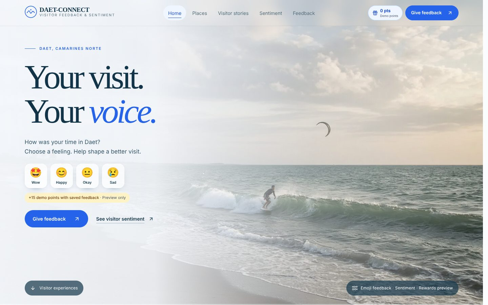
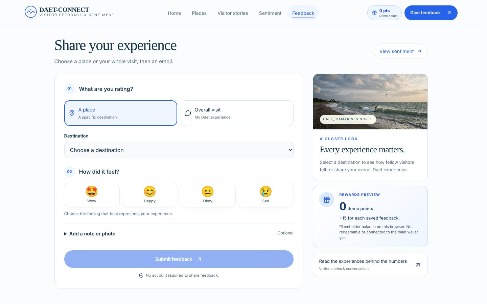
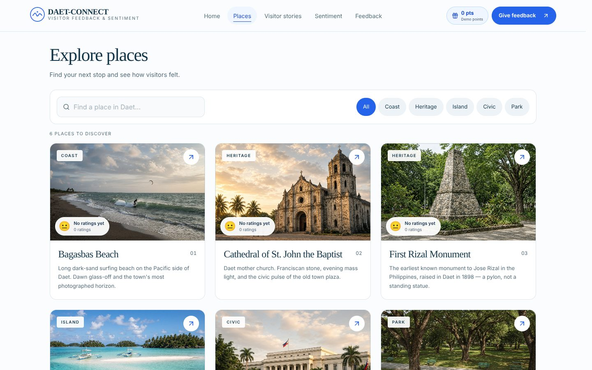

# Paul Vincent N. Villaflores — Full-Stack Developer Portfolio

A premium, responsive developer portfolio built with **Next.js 15, React 19, TypeScript and TailwindCSS 4**. It is fully static: no backend, no database and no environment variables are needed to run or deploy it.

- **GitHub:** https://github.com/Villaflores04
- **Email:** tkpaulvincent042005@gmail.com
- **LinkedIn:** coming soon

## What it does

- Presents my profile, skills, education and featured project (DAET Pulse) as a fast single page.
- Opens with a **9-layer parallax landscape** (sky, stars, sun/moon, clouds, three mountain ranges, mist, pines, foreground ridge). Layers move at different rates on scroll and respond to the cursor on desktop.
- **Light and dark mode** with different scenes: sun and lavender peaks by day, moon, stars and indigo peaks by night. Follows the OS until you choose, then remembers your choice, with no flash on load.
- Shows **DAET Pulse screenshots** in a tabbed browser-and-phone gallery, plus its features, architecture, API endpoints, challenges and next steps.
- Responsive from 320px phones to wide desktops: floating pill navigation, full-screen mobile menu, active-section highlighting, scroll-progress bar and back-to-top.

## Tech stack

| Layer | Tools |
|---|---|
| Front-end | Next.js 15 (App Router), React 19, TypeScript, TailwindCSS 4, lucide-react, Geist font |
| Hosting | Vercel (static output) |
| Tooling | Vitest, GitHub Actions |

## Setup

```bash
git clone https://github.com/Villaflores04/portfolio.git
cd portfolio
npm install
npm run dev        # http://localhost:3000
```

| Script | Purpose |
|---|---|
| `npm run dev` | Start the dev server |
| `npm run build` / `npm start` | Production build / serve |
| `npm run typecheck` | TypeScript check |
| `npm test` | Unit tests (Vitest) |

**Deploy:** import the repo on Vercel (Framework Preset: Next.js). Optionally set `NEXT_PUBLIC_SITE_URL` to the deployed URL for correct social-preview metadata.

**Edit content:** everything (bio, skills, education, project details, links) lives in [`src/data/profile.ts`](src/data/profile.ts). Set `linkedin` there when it is ready.

## Performance

The parallax is built to stay smooth on modest hardware:

- **Scroll motion runs on the compositor.** Where the browser supports CSS scroll-driven animations (`animation-timeline: scroll()`, Chromium and recent Safari), the hero layers, ambient colour fields, section numerals and progress bar are animated entirely in CSS with no JavaScript on scroll. Other browsers fall back to a single `requestAnimationFrame` loop with cached measurements.
- **Cursor and scroll never fight.** Scroll uses the CSS `translate` property while the cursor uses `transform`, so they compose.
- **No expensive filters on moving content.** Backdrop blur is used only on the fixed nav and mobile menu; clouds and mist use gradients instead of animated blur; the star field is three box-shadow groups instead of ~110 animated elements.
- Work stops while the hero is off screen, and all motion is disabled under `prefers-reduced-motion`.

Measured in headless Chromium (software rendering, so absolute numbers are pessimistic), scrolling through the hero improved from about 7 fps with 67 janky frames to about 53 fps with 4, and 13 fps to 50 fps under 4x CPU throttling.

## Design system

| Piece | How it works |
|---|---|
| Landscape | `src/lib/scene.ts` generates mountains, hills, pines and stars from fixed seeds, so server and client always render identically. |
| Parallax | Each layer carries `--depth` (scroll factor) and `data-pointer` (cursor offset). `ParallaxRoot` handles the cursor and the fallback; CSS handles scroll. |
| Theming | CSS variables on `:root` / `.dark` drive every colour, including the sky, mountains, sun/moon, clouds and mist. |
| Micro-interactions | Cursor spotlight on cards, 3D-tilt developer card, shine buttons, scroll reveals, animated theme toggle. |

## Featured project: DAET Pulse

Tourism feedback system for the Municipality of Daet, Camarines Norte. Live demo: https://daetfeedback.vercel.app/ · Source: https://github.com/Villaflores04/daet_feedback. Built with Next.js, React, TypeScript, TailwindCSS, Zustand and Supabase (PostgreSQL + Storage). Screenshots in [`public/projects`](public/projects) were captured from a local production build against a fresh database (the six seeded places, no visitor feedback).

| Landing | Feedback form | Places |
|---|---|---|
|  |  |  |

## Project structure

```
app/                      routes, layout, global styles
src/components/           UI sections (hero, about, skills, project, gallery, education, contact…)
src/components/parallax/  parallax engine, landscape layers, ambient background, spotlight
src/data/profile.ts       all profile and project content in one place
src/lib/scene.ts          seeded generators for the parallax landscape
public/projects/          DAET Pulse screenshots
tests/                    Vitest unit tests
.github/workflows/        CI: typecheck, test, build
```

## Quality

- Security headers (`X-Frame-Options`, `X-Content-Type-Options`, `Referrer-Policy`, `Permissions-Policy`); no user input, forms or secrets.
- Accessible: semantic landmarks, skip link, keyboard-navigable tab gallery (arrow keys, Home/End), focus handling and scroll-lock in the mobile menu, 44px minimum touch targets, reduced-motion support.
- Checked in headless Chromium at 375, 768, 1024 and 1440px in both themes: no horizontal overflow and no console errors.
- CI runs typecheck, tests and build on every push and pull request.

## Limitations

- Cursor parallax is desktop-only; touch devices get scroll parallax.
- Verified in headless Chromium only, not on physical devices or other browsers.

## Author

**Paul Vincent N. Villaflores** — BSIT 4B, Our Lady of Lourdes College Foundation.
